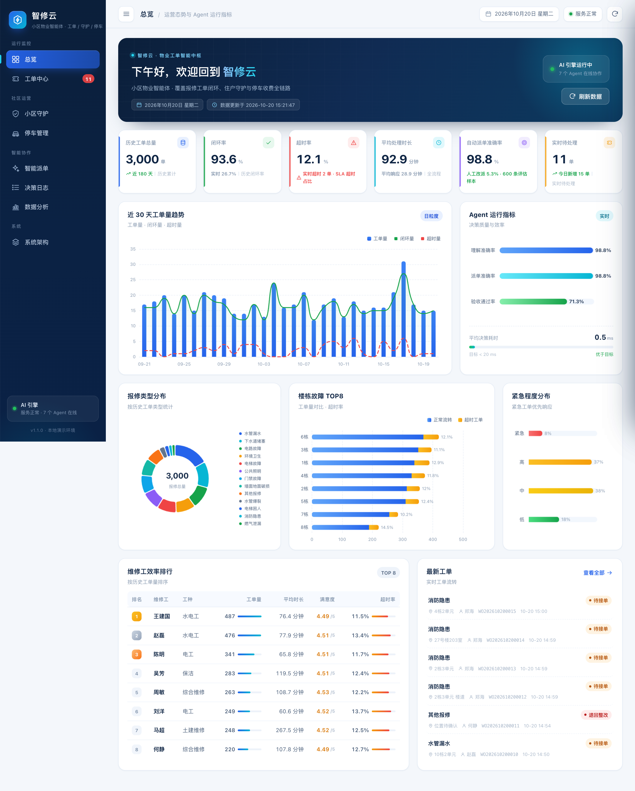
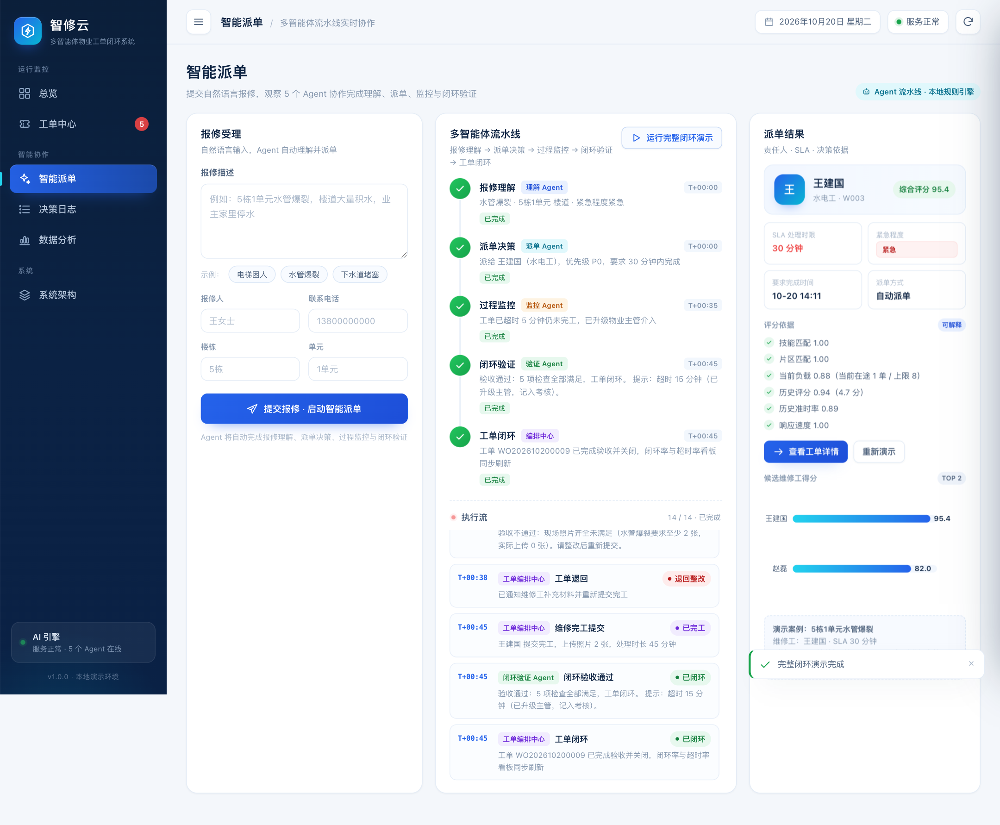
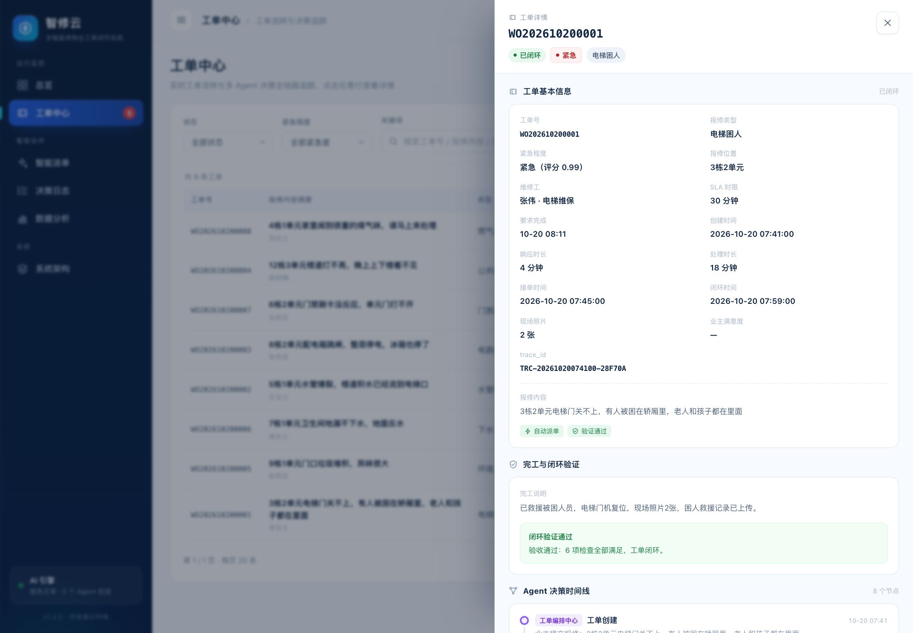
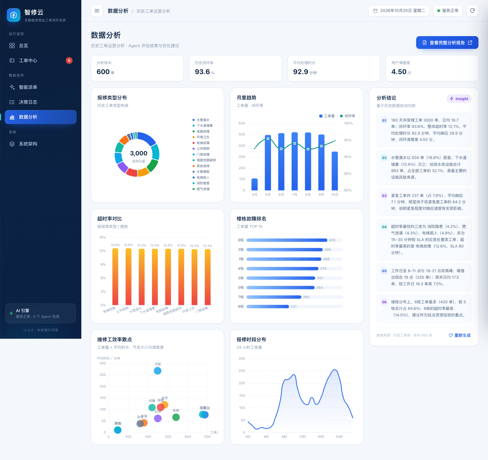
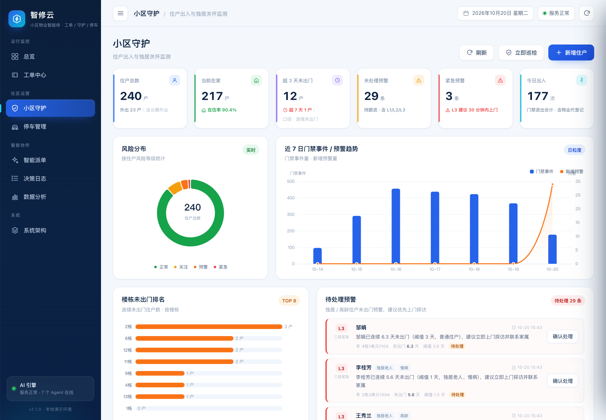
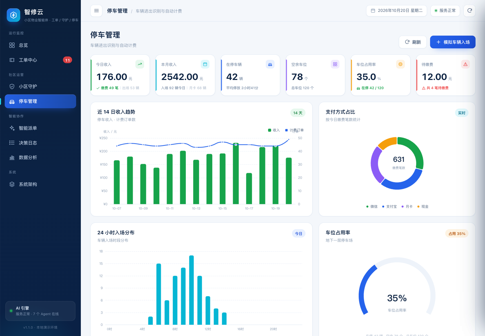
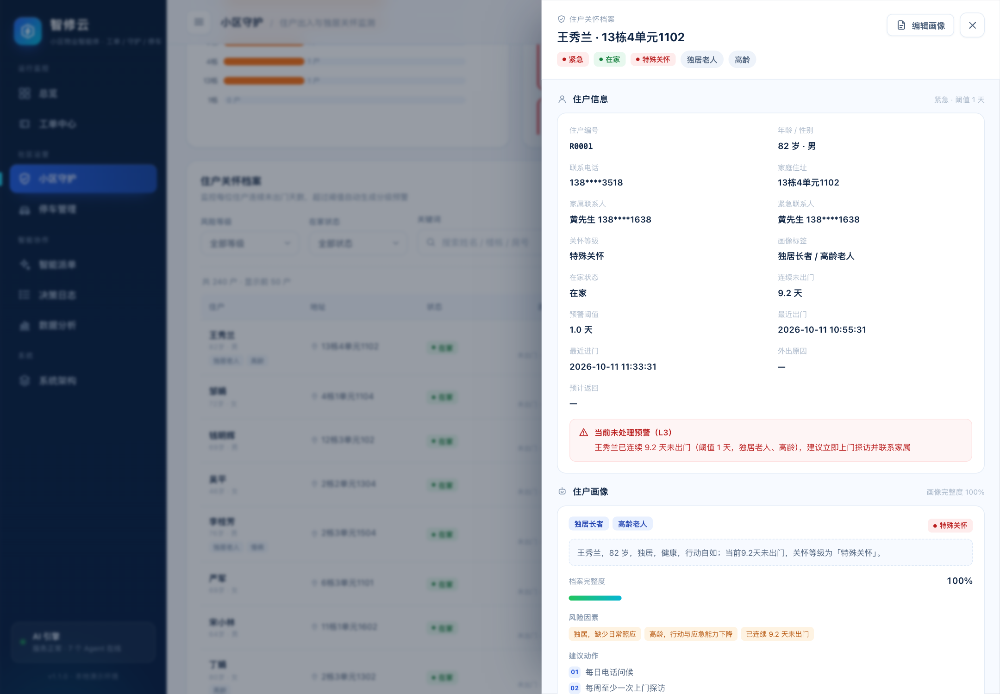
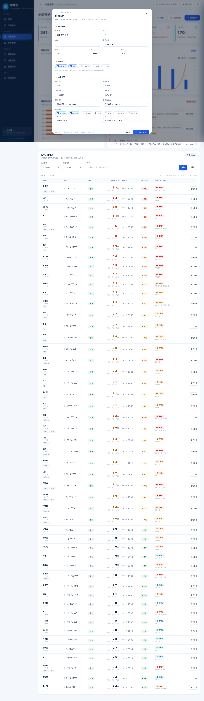
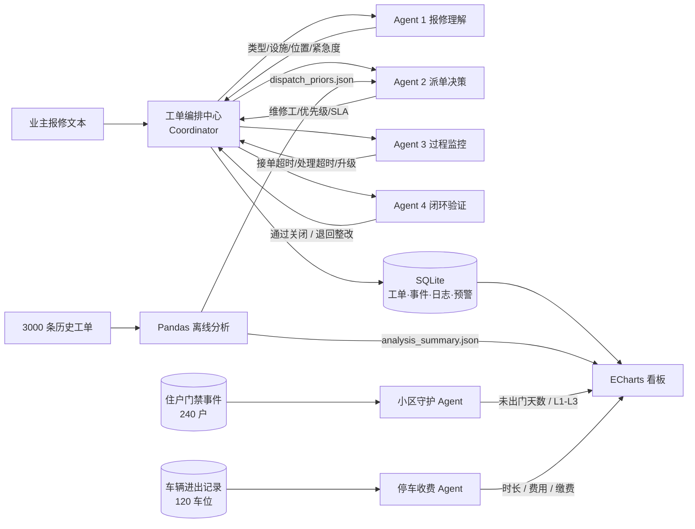

# 智修云 · 小区物业智能体

> 毕业设计/课程设计项目：**基于多智能体协同的物业报修工单自动派发与闭环验证系统**（已升级为小区物业智能体）
>
> 报修理解 → 智能派单 → 过程监控 → 闭环验证；并扩展 **小区守护**（住户连续未出门预警）与 **停车管理**（车辆进出自动计费收费）。7 个 Agent 协同，每一步决策都可追溯。

   

---

## 看板预览

| 总览 | 智能派单闭环演示 |
|---|---|
|  |  |

| 工单详情与决策时间线 | 数据分析 |
|---|---|
|  |  |

| 小区守护 | 停车管理 |
|---|---|
|  |  |

| 住户画像 | 新增/编辑住户 |
|---|---|
|  |  |

> 截图由系统实际运行后生成，数据来自 3000 条历史工单 + 8 条实时工单 + 240 名住户 + 140 辆车。


## 1. 项目亮点

| 能力 | 说明 |
|---|---|
| 多智能体协同 | 报修理解、派单决策、过程监控、闭环验证 4 个专职 Agent，由协调器状态机编排 |
| 自动闭环 | 完工后自动验收；缺照片/记录不全则退回整改，补充后再次验收，通过才关闭工单 |
| 超时治理 | 接单超时提醒、处理即将超时预警、处理超时自动升级物业主管 |
| 可追溯决策 | 每次理解/派单/监控/验收都记录 `rationale + confidence + 耗时 + 输入输出` |
| 数据驱动派单 | 用 3000 条历史工单的 Pandas 离线分析结果（类型时长、超时率、维修工画像）反哺在线评分 |
| 小区守护 | 240 名住户门禁出入建模；按年龄/独居/慢病标签设置差异化阈值，连续未出门自动生成 L1–L3 预警并支持物业确认 |
| 住户画像 | 每个住户生成结构化画像：独居/高龄/慢病/行动不便标签、关怀等级、风险因素、建议动作、画像完整度；支持页面新增住户、编辑健康/家属/服务需求等档案 |
| 停车收费 | 120 个车位、140 辆车；车辆进出自动识别，按 30 分钟免费、2 元/小时、单日封顶 30 元、月卡 300 元/月计费，支持待缴费与收费 |
| 自动巡检 | 小区守护 Agent 每 120 秒后台巡检一次住户状态；停车 Agent 在出场时自动计费并写决策日志 |
| 可视化答辩 | 总览、工单中心、小区守护、停车管理、智能派单、决策日志、数据分析、系统架构 8 个页面，ECharts 本地渲染 |
| 一键演示 | `POST /api/demo/run` 自动跑通「T+25 接单超时提醒 → T+35 升级主管 → T+38 缺照片退回 → T+45 补充照片闭环」 |

## 2. 30 秒跑起来

```bash
cd property-agent-system
./run.sh
# 打开 http://127.0.0.1:8000（新增「社区运营 → 小区守护 / 停车管理」）
```

首次运行会自动创建 `.venv`、生成 3000 条历史工单、运行离线分析、评估 Agent 准确率、初始化 SQLite，并生成 8 条实时工单、240 名住户、140 辆车与停车记录。若依赖已就绪，也可以手动：

```bash
python3 -m venv --system-site-packages .venv
.venv/bin/pip install -r requirements.txt
.venv/bin/python scripts/generate_data.py   # 3000 条历史工单（可重复）
.venv/bin/python scripts/analyze.py         # Pandas 分析 + 6 张图 + 分析报告
.venv/bin/python scripts/render_report.py   # 报告渲染为 HTML
.venv/bin/python scripts/evaluate_agents.py # 600 条样本 Agent 评估
.venv/bin/python scripts/init_db.py --force-history --seed-live --seed-community
.venv/bin/python -m uvicorn app.main:app --port 8000
```

> 系统也支持纯 API 使用：启动后访问 `http://127.0.0.1:8000/docs` 查看 Swagger。

## 3. 架构



### 工单状态机

```text
submitted ──理解──> understood ──派单──> assigned
                                          │
                                     维修工接单
                                          ▼
                                     processing
                                          │ 提交完工
                                          ▼
                                     completed
                                      /       \
                              验收通过 /         \ 验收退回
                                    ▼             ▼
                                 closed        returned
                                                  │ 补充材料重新提交
                                                  └──────> processing
```

## 4. Agent 设计：工单 4 个 + 社区 2 个

### Agent 1 报修理解 Agent（`app/agents/understanding.py`）

- **输入**：口语化报修描述，可附带楼栋/单元/房号。
- **输出**：报修类型（13 类）、设施类型、位置、紧急程度、关键实体、SLA、责任工种、置信度。
- **方法**：正则 + 关键词加权分类器；对「电梯困人/爆裂/燃气/火情」设置安全优先规则；对「老人/小孩/被困/大面积」自动升紧急；所有命中规则写入理由。
- **示例**：`3栋2单元电梯门关不上，有人被困` → 电梯困人 / 3栋2单元 / 紧急 / 30 分钟 / 张伟（电梯维保）。

### Agent 2 派单决策 Agent（`app/agents/dispatch.py`）

- **筛选**：按报修类型映射主工种，主工种无人时才启用兜底工种。
- **评分**：`0.32×技能 + 0.16×片区 + 0.20×负载 + 0.12×满意度 + 0.12×历史准时率 + 0.08×历史时长`。
- **输出**：责任人、优先级 P0–P3、SLA 截止时间、Top 5 候选得分明细、决策依据。
- **数据反哺**：从 `data/dispatch_priors.json` 读取历史类型时长、维修工超时率/满意度。

### Agent 3 过程监控 Agent（`app/agents/monitoring.py`）

- **接单超时**：紧急 10 分钟、高 15、中 30、低 60；超时生成 L1 提醒。
- **处理预警**：距截止 10 分钟生成 L0 预警；超过截止生成 L2 并升级物业主管。
- **去重**：同工单同类型未关闭预警不重复生成；每次巡检落一条 Agent 日志。

### Agent 4 闭环验证 Agent（`app/agents/verification.py`）

- **通用检查**：处理说明 ≥8 字、现场照片数量、完工时间、内容与报修类型匹配。
- **类型规则**：电梯困人/燃气泄漏/消防隐患为安全类硬时限；电梯困人需救援记录 + 2 张照片；燃气需检漏/浓度/通风/关阀记录；水管爆裂需 2 张照片。
- **输出**：`pass / return`、逐项检查表、得分、退回整改项；通过才写 `closed_at` 并关闭工单。

### Agent 5 小区守护 Agent（`app/agents/community.py`）

- **输入**：住户门禁出入事件、年龄、独居老人/慢病/行动不便/高龄标签、计划外出信息。
- **规则**：普通住户连续未出门 3 天、慢病/行动不便/高龄 2 天、独居老人 1 天触发预警；按超出阈值幅度分 L1/L2/L3。
- **输出**：未出门天数、风险等级、预警级别、关怀建议、判定依据。
- **自动巡检**：FastAPI 启动后台任务，每 120 秒扫描一次；登记进门/出门事件会自动解除未处理预警。

### Agent 6 停车收费 Agent（`app/agents/community.py`）

- **输入**：车牌、入场/出场时间、月卡有效期、停车规则。
- **计费**：30 分钟免费；超出后 2 元/小时（不足 1 小时按 1 小时）；单日封顶 30 元；有效月卡免费。
- **输出**：停车时长、计费小时、免费时长、应收金额、计费明细、是否月卡。
- **收费**：出场可现场选择微信/支付宝/现金完成收费；未缴费生成待缴费记录，支持后续补缴。

### 协调器（`app/agents/coordinator.py`）

- 管理状态流转、事件流、Agent 日志、监控预警、人工接管、演示编排。
- 人工改派会重置接单/处理时限，写入 `manual_reassign` 事件和 `human_takeover` 决策日志。
- 所有时间可注入，便于单元测试与演示复现。

## 5. 数据与离线分析

- **数据规模**：3000 条，13 类报修，12 名维修工，5 个小区，180 天（2026-04-24 ~ 2026-10-20），固定随机种子 `20261020`。
- **核心指标**：闭环率 **93.6%**、超时率 **12.1%**、平均处理时长 **92.9 分钟**、平均响应 **28.9 分钟**、满意度 **4.50**、自动派单占比 **94.2%**、人工改派率 **5.3%**。
- **分析维度**：类型/设施分布、楼栋排名、月度/日内趋势、超时归因、维修工效率、满意度。
- **产物**：
  - `data/historical_orders.csv`
  - `data/dispatch_priors.json`（在线派单先验）
  - `reports/analysis_summary.json`（看板指标）
  - `reports/历史工单分析报告.md` / `.html`（约 3300 字，含 6 张图）
  - `reports/figures/*.png`

## 6. Agent 准确率评估

`scripts/evaluate_agents.py` 从历史工单中随机抽取 600 条，以人工标注类型、紧急度、实际责任工种为 ground truth：

| 指标 | 结果 |
|---|---:|
| 报修类型理解准确率 | **98.83%** |
| 紧急程度判断准确率 | **96.50%** |
| 派单责任工种匹配率 | **99.17%** |
| 自动派单综合准确率（类型 + 工种） | **98.83%** |
| 闭环验收通过率（历史记录重放） | **71.33%** |
| 人工改派率（历史） | **5.30%** |
| Agent 平均决策耗时 | **0.46 ms** |

> 评估数据与规则同分布，指标偏乐观；验收通过率偏低主要因为历史记录中 16.7% 无照片、15% 处理说明与类型不匹配，恰好体现闭环验证规则的有效性。完整方法与误差样例见 `reports/agent_evaluation.json`。

## 7. 看板页面

| 页面 | 内容 |
|---|---|
| 总览 | 6 个 KPI、30 天趋势、类型环形图、楼栋 TOP8、紧急度、Agent 指标、最新工单 |
| 工单中心 | 状态/紧急度/关键词筛选、工单表格、右侧详情抽屉、事件时间线、决策日志、预警、接单/完工操作 |
| 智能派单 | 报修表单、示例文本、5 Agent 流水线动画、完整闭环演示播放、派单结果与候选得分 |
| 决策日志 | 按 Agent 过滤、置信度、耗时、rationale、output JSON 展开 |
| 数据分析 | 类型/月度/超时/楼栋/维修工效率/时段分布、分析结论、完整报告入口 |
| 小区守护 | 6 个 KPI、风险分布、7 日门禁/预警趋势、楼栋排名、待处理预警（可确认）、住户筛选表、住户详情抽屉、**新增住户/编辑画像**、登记外出、立即巡检 |
| 停车管理 | 6 个 KPI、14 日收入、24 小时入场、支付方式、占用率仪表盘、在停车辆、最近记录、模拟入场/出场/收费 |
| 系统架构 | 7 Agent 卡片、数据流、技术栈、创新点、演示流程 |

## 8. 目录结构

```text
property-agent-system/
├── app/
│   ├── agents/              # 工单 4 Agent + 社区 2 Agent + 协调器 + 基类
│   ├── services/analytics.py# 历史数据/看板聚合
│   ├── services/community.py# 小区守护：住户/门禁/预警
│   ├── services/parking.py  # 停车：进出/计费/收费/看板
│   ├── api/                 # community / parking 路由
│   ├── static/              # 原生 HTML/CSS/JS + 本地 ECharts
│   ├── config.py            # SLA/类型/工种/状态配置
│   ├── db.py                # SQLite 建表/初始化
│   ├── repository.py        # 数据访问层
│   ├── main.py              # FastAPI 路由
│   └── schemas.py           # Pydantic 请求模型
├── scripts/                 # 数据生成、分析、评估、初始化、社区/停车种子、画像补全
├── data/                    # CSV / SQLite / 派单先验
├── reports/                 # 分析报告、图表、Agent 评估
├── tests/                   # 29 个单元/接口测试
├── docs/                    # API 契约、系统设计、答辩脚本
└── run.sh                   # 一键启动
```

## 9. 测试

```bash
.venv/bin/python -m pytest -q
# 29 passed
```

覆盖：理解分类、派单工种、监控预警/升级、验收退回/重提、人工改派、完整演示链路、API 生命周期、404/校验、空数据看板、住户未出门阈值/去重/解除、住户画像新增/编辑、停车计费/进出场/缴费。

## 10. 技术栈

- 后端：Python 3.9+、FastAPI、Pydantic v2、Uvicorn
- Agent 编排：轻量自研状态机（无需 LangGraph，降低部署复杂度）
- 存储：SQLite（WAL）
- 离线分析：Pandas、NumPy、Matplotlib
- 前端：原生 HTML/CSS/JavaScript、ECharts 5.5（本地文件）
- 社区扩展：后台 asyncio 巡检、门禁/停车事件表、SQLite 聚合、梯度计费
- 测试：pytest、httpx/TestClient

## 11. 创新点

1. **多智能体协同的工单闭环机制**：从单点文本分类扩展到「理解—派单—监控—验收」全流程，验收不通过可退回并再次闭环。
2. **可追溯的 Agent 决策日志**：每一次分类、评分、预警、验收都有规则命中、候选得分、置信度和耗时，避免黑箱。
3. **离线数据分析与在线 Agent 结合**：历史时长/超时率/维修工画像形成 `dispatch_priors.json`，直接参与在线派单评分与 SLA 判断。

## 12. 已知边界

- 模拟数据而非真实物业生产数据，结论用于方法验证与系统演示。
- 文本理解采用可解释规则 + 关键词加权分类，未接入大模型；后续可将 LLM 作为兜底分类器并保留规则校验。
- 单机 SQLite 部署，适合课程设计与小规模试点；生产化需替换为 MySQL/PostgreSQL、消息队列与定时任务。
- 工单监控由页面/演示触发巡检；小区守护已使用后台 120 秒巡检，生产环境可统一替换为 APScheduler/Celery。
- 住户“未出门”基于门禁/出入事件模拟，不采集摄像头画面；真实部署需遵守隐私与数据合规要求，可采用门磁、门禁刷卡或脱敏事件。
- 停车计费规则为演示配置（30 分钟免费、2 元/小时、封顶 30 元/日、月卡 300 元），可按小区实际规则调整 `app/config.py` 和 `parking_lots`。

## 13. 答辩材料

- `deliverables/答辩PPT.pptx`：17 页答辩汇报（研究背景、架构、Agent、状态机、演示时间线、数据与评估、创新点）
- `deliverables/项目报告.docx` / `.pdf`：约 37 页毕业设计/课程设计报告初稿
- `docs/答辩演示脚本.md`：5 分钟现场讲解词与常见问答
- `reports/历史工单分析报告.html`：可直接在浏览器查看/打印的数据分析报告
- `docs/screenshots/`：系统页面真实运行截图
- `docs/API契约-社区扩展.md`：小区守护/停车管理/住户画像 API 契约
- 住户画像字段与录入表单：见 "住户画像" API 与页面「新增住户 / 编辑画像」
- 注：本次升级按当前要求只更新代码与 README，论文/PPT 未同步重做。

---

**答辩演示**：打开首页 → 点击「智能派单」→「运行完整闭环演示」→ 观察 5 个 Agent 依次点亮、T+25/T+35 两条预警、T+38 验收退回、T+45 补充照片后闭环 → 回总览查看看板指标变化。
