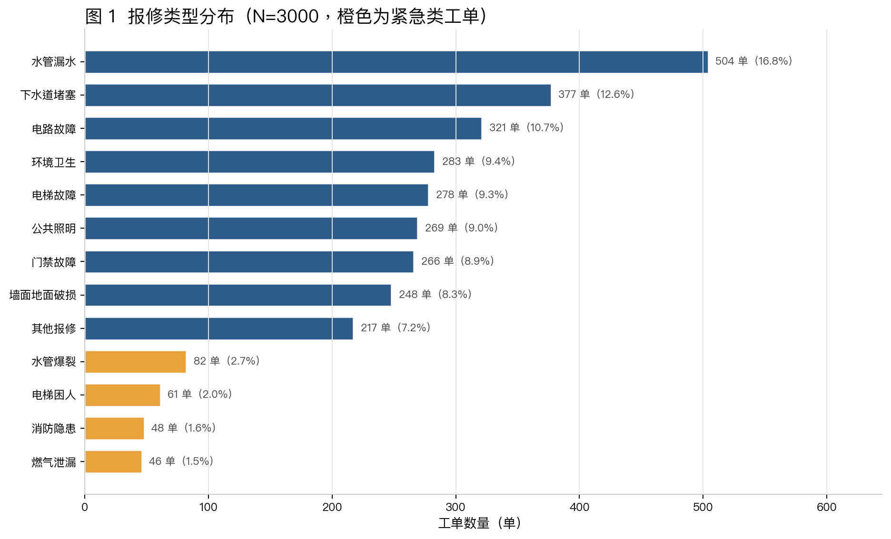
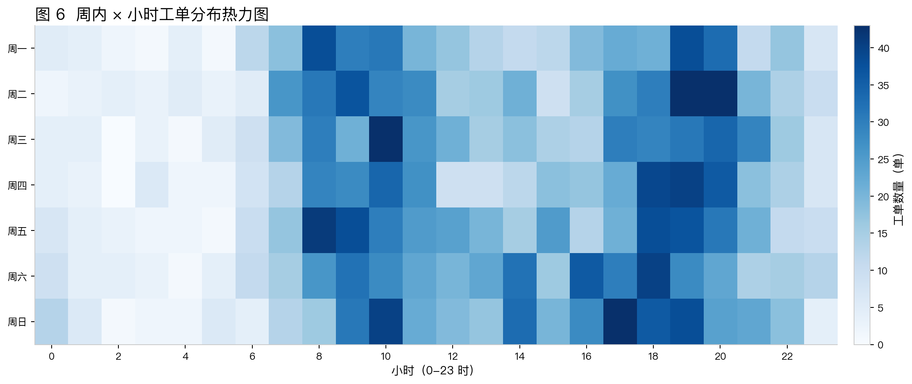
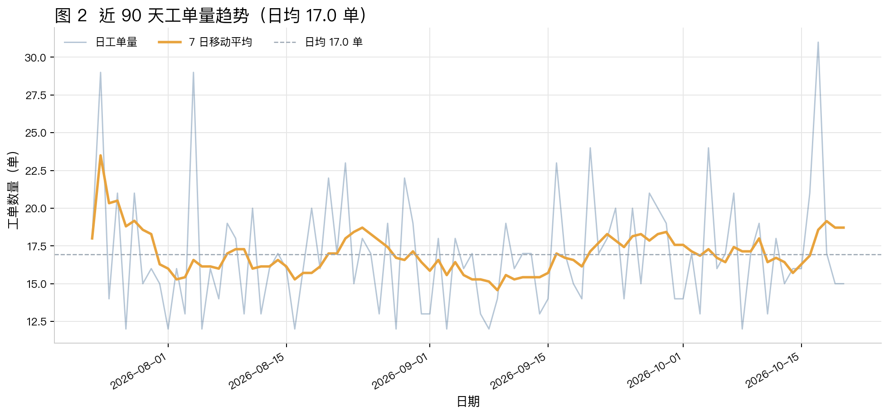
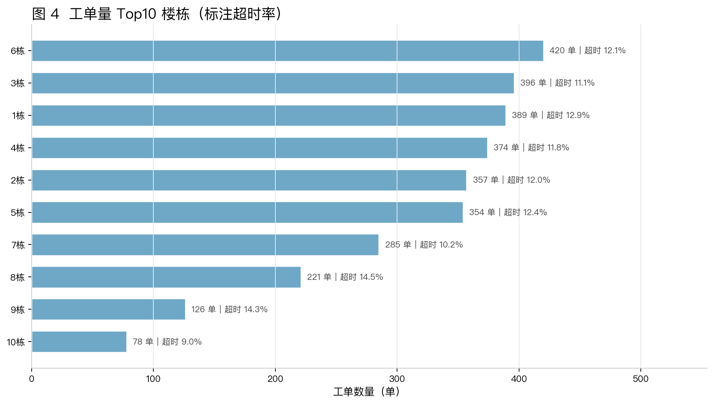
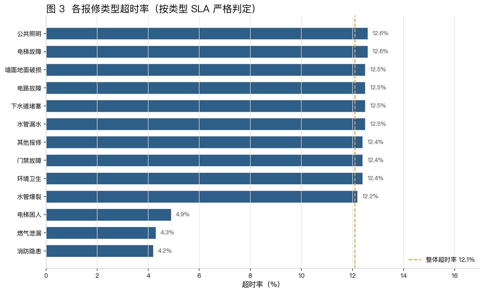
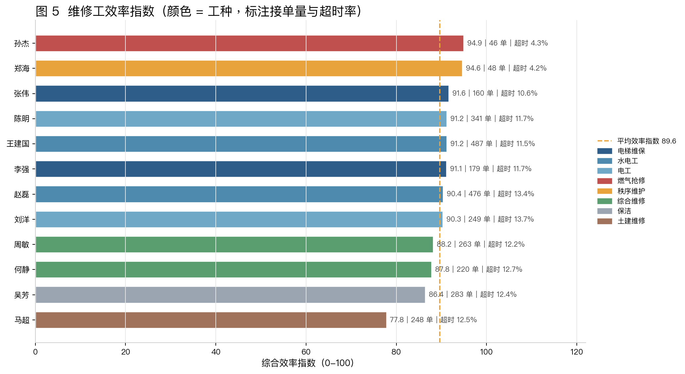

# 小区物业历史报修工单数据分析报告

**项目**：智修云 · 多智能体物业工单系统  
**数据文件**：`data/historical_orders.csv`（3000 条，2026-04-24 至 2026-10-20，共 180 天）  
**生成脚本**：`scripts/generate_data.py`（随机种子 20261020，可重复生成）  
**分析脚本**：`scripts/analyze.py`　**报告生成时间**：2026-10-20 14:24:25

## 摘要

本报告基于 3000 条小区物业历史报修工单，从报修类型、时空分布、超时与闭环、维修工效率四个维度进行离线分析，并提取可供在线派单 Agent 使用的先验特征。结果显示：整体闭环率 93.6%，超时率 12.1%，平均处理时长 92.9 分钟、平均响应 28.9 分钟，闭环满意度 4.50 分；给排水类工单占比最高，工作日 8-11 点与 18-21 点形成明显双高峰；超时与未闭环高度相关，超时工单闭环率仅 57.5%。分析结果已沉淀为 `data/dispatch_priors.json`，直接服务于自动派单决策。

## 一、数据说明与字段

### 1.1 数据范围与性质

数据覆盖 5 个小区（锦绣家园、翠湖名居、阳光里、江南雅苑、金域蓝湾）、13 类报修、12 名维修工，时间跨度 180 天（2026-04-24 ~ 2026-10-20），共 3000 条工单，日均 16.7 单。数据依据真实物业工单业务规则与业主作息规律模拟生成，固定随机种子 20261020，可完全复现；不包含任何真实业主隐私信息，仅用于系统开发、算法离线验证与毕业论文实验。

### 1.2 字段说明

| 字段 | 类型 | 含义 |
|---|---|---|
| order_id | 字符串 | 工单编号，WO + 日期 + 当日流水号 |
| created_at | 时间 | 业主报修时间（YYYY-MM-DD HH:MM:SS） |
| community | 字符串 | 小区名称，共 5 个 |
| building | 字符串 | 楼栋，如 5栋 |
| unit | 字符串 | 单元，如 1单元 |
| room | 字符串 | 房号，如 1203 |
| description | 字符串 | 业主口语化报修描述，含地点与症状 |
| repair_type | 类别 | 报修类型，13 类之一 |
| facility_type | 类别 | 设施类型，由报修类型唯一决定 |
| urgency | 类别 | 紧急程度：紧急/高/中/低 |
| worker_id | 字符串 | 维修工编号 W001-W012 |
| worker_name | 字符串 | 维修工姓名 |
| worker_trade | 类别 | 维修工工种，与报修类型匹配 |
| dispatch_mode | 类别 | 派单方式：auto 自动 / manual 人工 |
| reassigned | 0/1 | 是否发生人工改派 |
| response_minutes | 数值 | 从报修到接单的响应时长（分钟） |
| duration_minutes | 数值 | 从接单到完工的处理时长（分钟） |
| sla_minutes | 整数 | 该类型规定处理时限（分钟） |
| is_timeout | 0/1 | 是否超时，严格由 duration_minutes > sla_minutes 判定 |
| is_closed | 0/1 | 是否已闭环 |
| satisfaction | 数值 | 闭环满意度，3.2-5.0；未闭环为空 |
| photos_count | 整数 | 处理照片数量，0-4 张 |
| result_note | 字符串 | 处理记录短句；未闭环可为空 |
| source | 类别 | 报修来源：业主App/电话/微信小程序/前台登记 |

### 1.3 数据质量校验

分析前对数据执行了严格校验：① 工单数量恰好 3000 行、字段顺序与契约一致；② 13 类报修类型与（设施类型、紧急程度、SLA、责任工种）的映射 100% 合法，例如“电梯困人 → 电梯 / 紧急 / 30 分钟 / 电梯维保”；③ `is_timeout` 与 `duration_minutes > sla_minutes` 逐行严格一致；④ 维修工编号、姓名、工种三者一致，且每类工单只派给对应工种；⑤ 闭环工单满意度均落在 3.2-5.0，未闭环工单满意度为空；⑥ 各紧急程度响应时长分别落在 2-15、5-30、10-60、20-120 分钟区间内。上述校验全部通过，数据可直接用于统计分析与 Agent 先验提取。

## 二、分析方法

### 2.1 预处理

使用 pandas 读取 CSV 并解析 `created_at`，派生日期、月份、小时、星期、是否周末等字段，将数值列转换为数值类型。分析过程中不剔除任何记录，未闭环工单在满意度、处理记录等字段上的空值按业务含义保留，不参与对应指标的均值计算。

### 2.2 统计口径

- **闭环率** = `is_closed = 1` 的工单数 / 工单总数；
- **超时率** = `is_timeout = 1` 的工单数 / 工单总数，超时仅由处理时长是否超过该类型 SLA 严格判定；
- **平均处理时长 / 平均响应时长** 分别为 `duration_minutes`、`response_minutes` 的算术均值；
- **P90 时长** 为同一类型工单处理时长的 90% 分位数，用于刻画长尾；
- **满意度** 仅统计已闭环工单，未闭环不计入；
- 分类型、分楼栋、分维修工的比率均以对应分组工单数为分母。

### 2.3 维修工效率指数

为综合衡量维修工表现，构造效率指数：

`效率指数 = 100 × (0.5 × 准时率 + 0.3 × 满意度 / 5 + 0.2 × 时长指数)`

其中准时率 = 1 − 超时率，时长指数 = min(1, 全部工单平均时长 / 该维修工平均时长)。该指数兼顾“按时完成、业主满意、处理高效”三个目标，数值越高表示综合效率越好，用于横向对比与派单参考。

### 2.4 工具与可复现性

分析使用 Python 3、pandas 2.3.3、numpy 与 matplotlib 3.9.4；随机种子固定，任何一次重新生成与重新分析都会得到一致的数值结果。

## 三、总体指标

| 指标 | 数值 | 统计口径 |
|---|---|---|
| 工单总数 | 3000 单 | CSV 全部记录 |
| 时间范围 | 2026-04-24 ~ 2026-10-20（180 天） | created_at 最小/最大值 |
| 日均工单量 | 16.7 单/天 | 工单总数 / 天数 |
| 闭环率 | 93.6% | is_closed = 1 占比 |
| 超时率 | 12.1% | is_timeout = 1 占比 |
| 平均处理时长 | 92.9 分钟 | duration_minutes 均值 |
| 平均响应时长 | 28.9 分钟 | response_minutes 均值 |
| 闭环满意度 | 4.50 分 | 闭环工单 satisfaction 均值 |
| 自动派单率 | 94.2% | dispatch_mode = auto 占比 |
| 人工派单率 | 5.8% | dispatch_mode = manual 占比 |
| 改派率 | 5.3% | reassigned = 1 占比 |
| 未闭环工单 | 193 单 | is_closed = 0 记录 |

从总体看，系统在 180 天内处理 3000 单，闭环率 93.6%、超时率 12.1%，平均响应 28.9 分钟，平均处理 92.9 分钟，闭环满意度 4.50 分。自动派单占比 94.2%，人工派单与改派分别占 5.8% 和 5.3%，说明绝大多数工单可由规则引擎自动完成派发，人工主要介入复杂或异常工单。

## 四、报修类型分析

### 4.1 类型分布

| 报修类型 | 工单数 | 占比 | 紧急程度 | SLA(分钟) | 平均时长 | P90 | 超时率 | 满意度 |
|---|---|---|---|---|---|---|---|---|
| 水管漏水 | 504 | 16.8% | 高 | 120 | 84.9 | 127.3 | 12.5% | 4.51 |
| 下水道堵塞 | 377 | 12.6% | 中 | 120 | 78.9 | 126.4 | 12.5% | 4.50 |
| 电路故障 | 321 | 10.7% | 高 | 60 | 42.8 | 62.1 | 12.5% | 4.49 |
| 环境卫生 | 283 | 9.4% | 低 | 480 | 119.5 | 507.2 | 12.4% | 4.51 |
| 电梯故障 | 278 | 9.3% | 高 | 60 | 44.7 | 63.9 | 12.6% | 4.48 |
| 公共照明 | 269 | 9.0% | 中 | 240 | 88.5 | 252.3 | 12.6% | 4.54 |
| 门禁故障 | 266 | 8.9% | 中 | 240 | 103.1 | 249.4 | 12.4% | 4.52 |
| 墙面地面破损 | 248 | 8.3% | 低 | 480 | 267.5 | 504.5 | 12.5% | 4.52 |
| 其他报修 | 217 | 7.2% | 中 | 240 | 114.6 | 250.1 | 12.4% | 4.51 |
| 水管爆裂 | 82 | 2.7% | 紧急 | 30 | 21.4 | 32.2 | 12.2% | 4.46 |
| 电梯困人 | 61 | 2.0% | 紧急 | 30 | 18.0 | 23.4 | 4.9% | 4.54 |
| 消防隐患 | 48 | 1.6% | 紧急 | 15 | 9.6 | 12.0 | 4.2% | 4.44 |
| 燃气泄漏 | 46 | 1.5% | 紧急 | 15 | 10.3 | 13.4 | 4.3% | 4.51 |



水管漏水（504 单，16.8%）、下水道堵塞（377 单，12.6%）与电路故障（321 单，10.7%）是最高频的三类报修。从设施维度看，给排水 963 单（32.1%）、电梯 339 单（11.3%）、电气 321 单（10.7%）、环境 283 单（9.4%）、照明 269 单（9.0%）；给排水类工单量明显高于其他设施，是物业日常运维最主要的压力来源；电梯类工单虽然总量不大，但包含电梯困人等紧急场景，安全权重远高于其数量占比。

### 4.2 类型与紧急程度

各类型紧急程度分布为 紧急 237 单（7.9%）、高 1103 单（36.8%）、中 1129 单（37.6%）、低 531 单（17.7%）。紧急工单平均响应 7.1 分钟，远快于低紧急度工单的 64.2 分钟，表明派单与接单流程对紧急程度做出了实质响应。SLA 方面，15~30 分钟的短时限类型（燃气泄漏、消防隐患、电梯困人、水管爆裂）共同构成安全底线，其中电梯困人、燃气泄漏、消防隐患的超时率分别仅 4.9%、4.3%、4.2%；而 240~480 分钟的长时限类型（门禁故障、公共照明、墙面地面破损等）超时率相对更高，可能与配件到货周期、业主在家时间等因素有关。

## 五、时空分布

### 5.1 小时与周内规律

从小时分布看，工单呈现明显的“双高峰”特征：8-11 点合计 834 单，占 27.8%；18-21 点合计 848 单，占 28.3%；峰值出现在 19 点（255 单）和 10 点（235 单）。0-6 点仅 204 单，占 6.8%，与业主作息高度吻合。周末共 909 单（占 30.3%），周末日均 17.5 单，比工作日的 16.3 单高 7.0%，说明业主在家时间越长，报修意愿越强。



### 5.2 日趋势与月度波动

近 90 天工单量在 12~31 单/天之间波动，日均 17.0 单，整体平稳，没有长期恶化趋势。月度上，完整月份（2026-05 ~ 2026-09）的月工单量在 496~520 单之间，2026-07 最多（520 单，超时率 10.0%）；首尾两个月为不完整月份（2026-04 自 24 日起、2026-10 截至 20 日），分别 107 单与 347 单，不宜直接与整月对比。



| 月份 | 工单数 | 闭环率 | 超时率 | 平均处理时长(分钟) |
|---|---|---|---|---|
| 2026-04 | 107 | 92.5% | 17.8% | 113.7 |
| 2026-05 | 496 | 95.4% | 9.5% | 89.2 |
| 2026-06 | 512 | 92.4% | 14.3% | 90.5 |
| 2026-07 | 520 | 94.0% | 10.0% | 89.7 |
| 2026-08 | 518 | 92.3% | 11.6% | 88.7 |
| 2026-09 | 500 | 93.2% | 12.6% | 102.5 |
| 2026-10 | 347 | 94.8% | 13.8% | 92.8 |

### 5.3 楼栋分布

64.6% 的工单集中在前 5 栋楼，其中 6栋工单最多（420 单，占 14.0%）。在工单量不少于 60 单的楼栋中，8栋的超时率最高（14.5%），建议作为驻点人员与备件前置的重点楼栋，并进一步排查其工单结构与维修动线。



| 楼栋 | 工单数 | 占比 | 超时率 | 平均处理时长(分钟) |
|---|---|---|---|---|
| 6栋 | 420 | 14.0% | 12.1% | 90.2 |
| 3栋 | 396 | 13.2% | 11.1% | 91.2 |
| 1栋 | 389 | 13.0% | 12.9% | 91.7 |
| 4栋 | 374 | 12.5% | 11.8% | 91.8 |
| 2栋 | 357 | 11.9% | 12.0% | 98.6 |
| 5栋 | 354 | 11.8% | 12.4% | 95.0 |
| 7栋 | 285 | 9.5% | 10.2% | 90.6 |
| 8栋 | 221 | 7.4% | 14.5% | 98.9 |
| 9栋 | 126 | 4.2% | 14.3% | 93.6 |
| 10栋 | 78 | 2.6% | 9.0% | 82.5 |

## 六、超时与闭环分析

| 分组 | 工单数 | 闭环率 | 平均处理时长(分钟) | 平均响应(分钟) | 平均满意度 |
|---|---|---|---|---|---|
| 超时工单 | 362 | 57.5% | 223.1 | 28.7 | 4.19 |
| 非超时工单 | 2638 | 98.5% | 75.1 | 28.9 | 4.53 |

超时与闭环之间存在显著关联：超时工单闭环率仅 57.5%，而非超时工单闭环率达到 98.5%，相差 41.0 个百分点；3000 单中有 193 单未闭环，其中 79.8% 属于超时工单。可见“超时 → 业主不满 / 返工 → 未闭环”是主要风险链路。分类型看，超时率最低的是消防隐患（4.2%）、燃气泄漏（4.3%）和电梯困人（4.9%），均属于 SLA 短、处置流程标准化的紧急工单；超时率最高的是电梯故障（12.6%）。

满意度方面，闭环工单平均 4.50 分，其中非超时工单 4.53 分、超时工单 4.19 分，超时直接拉低约 0.34 分。分类型满意度最高的是公共照明（4.54），最低的是消防隐患（4.44）；最低类型样本量为 48 单，差异不宜过度解读，建议结合回访记录进一步分析。



## 七、维修工效率

| 工号 | 姓名 | 工种 | 工单数 | 平均时长(分钟) | 超时率 | 满意度 | 效率指数 |
|---|---|---|---|---|---|---|---|
| W007 | 孙杰 | 燃气抢修 | 46 | 10.3 | 4.3% | 4.51 | 94.9 |
| W010 | 郑海 | 秩序维护 | 48 | 9.6 | 4.2% | 4.44 | 94.6 |
| W001 | 张伟 | 电梯维保 | 160 | 37.9 | 10.6% | 4.48 | 91.6 |
| W003 | 王建国 | 水电工 | 487 | 76.4 | 11.5% | 4.49 | 91.2 |
| W005 | 陈明 | 电工 | 341 | 65.8 | 11.7% | 4.51 | 91.2 |
| W002 | 李强 | 电梯维保 | 179 | 41.6 | 11.7% | 4.50 | 91.1 |
| W004 | 赵磊 | 水电工 | 476 | 77.9 | 13.4% | 4.51 | 90.4 |
| W006 | 刘洋 | 电工 | 249 | 60.6 | 13.7% | 4.52 | 90.3 |
| W008 | 周敏 | 综合维修 | 263 | 108.7 | 12.2% | 4.53 | 88.2 |
| W012 | 何静 | 综合维修 | 220 | 107.8 | 12.7% | 4.49 | 87.8 |
| W009 | 吴芳 | 保洁 | 283 | 119.5 | 12.4% | 4.51 | 86.4 |
| W011 | 马超 | 土建维修 | 248 | 267.5 | 12.5% | 4.52 | 77.8 |

从接单量看，王建国承接最多（487 单），是给排水类工单的主力；郑海准时率最高（95.8%）。综合效率指数最高的是孙杰（94.9），其平均处理时长 10.3 分钟、超时率 4.3%、满意度 4.51，属于“快、稳、好评”的骨干维修工。整体看，同一工种内部也存在效率差异，说明在技能匹配的前提下，结合历史准时率与处理时长进行二次排序，可以进一步提升派单质量。



## 八、Agent 派单可用的先验特征

分析结果已写入 `data/dispatch_priors.json`，供在线派单 Agent 直接加载，主要包括：

- **类型先验 type_stats**：每类报修的工单占比、平均时长、P90 时长、超时率、SLA 与责任工种。派单 Agent 可用 P90 时长估计工单复杂度，用超时率计算维修工历史准时率，用工种完成技能匹配。
- **维修工先验 worker_stats**：W001-W012 的接单量、平均时长、超时率、满意度与所属片区，用于多因子评分中的可靠性、速度与负载参考。
- **紧急程度先验 urgency_distribution**：各紧急程度的单量与平均响应时长，可校准不同优先级工单的响应预期。
- **时间先验 hour_distribution / daily_trend**：小时与近 90 天日单量分布，用于预测高峰时段负载、提前安排值班。
- **楼栋先验 building_stats**：各楼栋单量与超时率，可辅助片区划分与驻点资源投放。

以水管漏水为例，其先验 P90 时长为 127.3 分钟、超时率 12.5%、责任工种为水电工；派单时可先按工种筛出候选人，再结合候选人的历史准时率与平均时长计算期望完成时间，优先选择能在 SLA 内完成的维修工。

## 九、结论与改进建议

1. 180 天共受理工单 3000 单，日均 16.7 单；闭环率 93.6%，整体超时率 12.1%，平均处理时长 92.9 分钟，平均响应 28.9 分钟，闭环满意度 4.50 分。
2. 水管漏水以 504 单（16.8%）居首，下水道堵塞（12.6%）次之；给排水类设施合计 963 单，占全部工单的 32.1%，是最主要的设施风险来源。
3. 紧急工单共 237 单（占 7.9%），平均响应 7.1 分钟，明显快于低紧急度工单的 64.2 分钟，说明紧急程度对响应速度有实质影响。
4. 超时率最低的三类为 消防隐患（4.2%）、燃气泄漏（4.3%）、电梯困人（4.9%），多为 15~30 分钟短 SLA 的应急处置类工单；超时率最高的是 电梯故障（12.6%，SLA 60 分钟）。
5. 工作日呈 8-11 点与 18-21 点双高峰，峰值出现在 19 点（255 单）；周末日均 17.5 单，较工作日 16.3 单高 7.0%。
6. 楼栋分布上，6栋工单最多（420 单），前 5 栋合计占 64.6%；8栋的超时率最高（14.5%），建议作为驻点资源投放的重点。
7. 维修工中孙杰效率指数最高（94.9），超时率 4.3%、满意度 4.51；王建国承接工单最多（487 单）。
8. 未闭环工单共 193 单，其中 79.8% 为超时工单；超时工单闭环率仅 57.5%，远低于非超时工单的 98.5%，超时是导致工单无法闭环的首要风险因素。

## 十、图表清单与复现方式

| 图号 | 文件 | 内容 |
|---|---|---|
| 图 1 | figures/01_type_distribution.png | 报修类型分布 |
| 图 2 | figures/02_daily_trend.png | 近 90 天工单趋势 |
| 图 3 | figures/03_timeout_by_type.png | 各类型超时率 |
| 图 4 | figures/04_building_ranking.png | 工单量 Top10 楼栋 |
| 图 5 | figures/05_worker_efficiency.png | 维修工效率分布 |
| 图 6 | figures/06_hourly_heatmap_or_bar.png | 周内-小时热力图 |

复现命令：

```bash
.venv/bin/python scripts/generate_data.py
.venv/bin/python scripts/analyze.py
```

报告中的全部数字均来自 `data/historical_orders.csv` 的实际计算，并与 `reports/analysis_summary.json`、`data/dispatch_priors.json` 保持一致。
